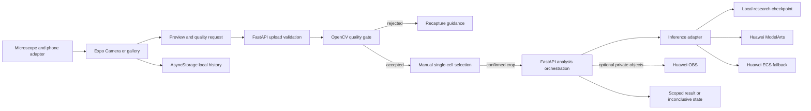

# HemoScope AI architecture

HemoScope AI separates capture, quality control, manual cell selection, inference, and session history so each step can be tested independently. The prototype analyzes only a user-confirmed single-cell crop; the backend must never pass a rejected image to a classifier.

## Module boundaries

- Mobile owns screens, camera and gallery permission requests, field preview, quality feedback, crop interaction, typed API calls, and local history. It never imports Python code or Huawei credentials.
- API owns request validation, upload size and type controls, quality assessment, orchestration, response mapping, and consistent errors.
- ML owns manifests, subject-separated splitting, preprocessing, MobileNetV3-Small model construction, training, evaluation, and local checkpoint inference.
- Inference adapters own provider-specific model execution. The local development adapter loads the versioned research bundle; Huawei adapters remain separate cloud integration boundaries. Routes depend on adapter interfaces, not provider SDK calls.
- Hardware documentation records the adapter, phone, microscope, optics, and repeatable capture procedure.

## Data flow and safety gates

1. Capture or import a complete microscope field.
2. Submit the field to POST /quality.
3. If rejected, return recapture_required guidance and stop.
4. If accepted, manually select one complete cell and confirm the normalized crop rectangle.
5. Submit the source image and rectangle with crop_confirmed=true to POST /analyze; the backend extracts the selected crop.
6. Run crop quality checks again. A failed check returns recapture_required without calling the inference adapter.
7. Canonicalize an accepted crop to RGB PNG, stripping source metadata before inference.
8. With no model configured, return an inconclusive response with inference_mode=unavailable and no label or score. The opt-in local provider loads the bound research checkpoint and applies its versioned policy. A configured but unavailable provider returns a structured error. The opt-in development mock returns inference_mode=simulated and no model score.
9. Keep history local by default. No server session store is enabled.

## Contracts and dependencies

Pydantic models in services/api/app/schemas define request and response data. scripts/export_openapi.py creates the OpenAPI snapshot, and scripts/generate_api_types.py creates TypeScript schema types from that snapshot. CI regenerates both and checks for drift. Modules do not import from one another's implementation folders; shared data moves through the contract.

## Availability and security boundary

The local API can start without PyTorch, a checkpoint, training data, or Huawei access. Cloud credentials are server-side environment values only. Supabase Auth token checks are implemented and can be enabled for hosted image routes; TLS termination, request rate limiting, and server retention/deletion controls remain deployment requirements before accepting remote uploads.
