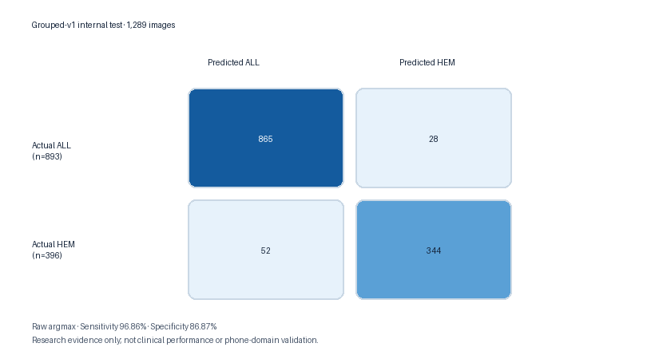

# Final candidate evaluation v1

Date: 17 November 2026. This report records one bounded model comparison and the single evaluation of the selected grouped candidate's internal test partition. It is research evidence only.

## Selected provisional candidate

The selected research candidate is `hemoscope-mobilenetv3-small-grouped-lowlr-v1`, checkpoint SHA-256 `58b80cd5ce7478ba218a7f374715f849734a4665b2e7d219db2cf56752cf2b98`. It uses MobileNetV3-Small, RGB bilinear square resize to 224×224, ImageNet normalization, seed 42, AdamW at learning rate `3e-5`, weight decay `1e-4`, batch size 32, and two initial frozen-backbone epochs. The frozen dependency-group split hash is `38a8b633f49592dae8f068942af6494d6d7a636723b7d3e439f16929cdad564a`.

This candidate was chosen from validation evidence before running the grouped internal test. Four existing runs used the same frozen 1,486-image validation partition:

| Existing run | Weighted F1 | ALL sensitivity | HEM specificity | Validation loss |
| --- | ---: | ---: | ---: | ---: |
| Grouped baseline, learning rate 0.0003 | 84.30% | 95.05% (864/909) | 68.63% (396/577) | 0.37178 |
| Grouped, learning rate 0.00003 | **85.83%** | 92.08% (837/909) | **76.43%** (441/577) | **0.34545** |
| Grouped, learning rate 0.00001 | 83.81% | 90.10% (819/909) | 74.35% (429/577) | 0.37120 |
| Frozen feature extractor | 77.85% | 80.86% (735/909) | 72.96% (421/577) | 0.46188 |

The lower learning rate had the strongest validation weighted F1 and lowest validation loss in this small, finite comparison. This does not establish an optimum or clinical performance. Repeated experiments on the same validation partition can overfit it; no more tuning should use the held-out result below.

## One-time internal test result

The selected checkpoint was evaluated once on the frozen grouped-v1 test partition after the candidate and validation-based policy were fixed. The evaluation ran on CPU with zero data-loader workers because MPS is unavailable in this Codex execution environment and the worker-based attempt could not create PyTorch shared memory. The checkpoint was not changed.

| Actual class | Predicted ALL | Predicted HEM | Total |
| --- | ---: | ---: | ---: |
| ALL | 865 | 28 | 893 |
| HEM | 52 | 344 | 396 |

| Metric | Result |
| --- | ---: |
| Weighted F1 | 93.74% |
| ALL sensitivity | 96.86% (865/893) |
| HEM specificity | 86.87% (344/396) |
| Mean weighted loss | 0.20553 |
| Sample count | 1,289 |

This is a source-dataset internal result, not phone-microscope or clinical performance. The test partition has 13 source IDs grouped into only 9 dependency groups. The source metadata does not prove those are distinct patients. An earlier baseline test result was already examined during the dataset/grouping investigation; the revised grouped-v1 test therefore must not be presented as a pristine external validation cohort. The earlier result was 62.70% weighted F1 and 21.18% specificity on 1,040 images. No training, threshold, or candidate decision was changed using the new grouped test result.

Option B remains bound to this checkpoint: ALL score below 0.30 gives the scoped low-score message, `[0.30, 0.70)` is inconclusive, and `>=0.70` requires review. The thresholds were selected from validation; the test report above describes raw 0.5 argmax classification and is not used to adjust those thresholds. Scores are uncalibrated model outputs, not probabilities.

The generated evaluation files are ignored local artifacts at `ml/artifacts/baseline-grouped-lowlr-v1/test-metrics.json` and `model-metadata.json`. Metadata preserves the actual MPS training configuration and records CPU as the evaluation device.

## Automatic crop decision

The separate BCCD detector is a generic blood-cell localizer, not a leukemia classifier. Its BCCD validation performance at the fixed score threshold 0.25 was WBC AP50 97.39%, recall 98.85% (86/87), precision 35.98%, and 1.76 false-positive boxes per image. On the independently sourced NIH/NLM smartphone malaria Polygon Set, it found none of the 51 annotated WBC polygons at IoU 0.50: WBC AP50 0, 0/51 recall, and 221 false-positive WBC boxes over 165 fields. The evaluation and limitations are documented in [the smartphone detector report](SMARTPHONE_DETECTOR_EVALUATION_V1.md).

The detector is not connected to the mobile/API flow. The classifier only accepts a manually selected, confirmed cell crop. Available annotations and cross-domain results do not support automatic disease-region proposals or an automatic-crop claim. A WBC proposal, even if later supported, must not be represented as evidence of ALL/HEM status.

## Model card and source limits

This report supplements the preliminary model card in the local inference handoff bundle. Dataset provenance, grouping limitations, intended use, preprocessing, thresholds and known failure modes are described there. The C-NMC data and NIH/NLM smartphone data remain outside Git. Their source conditions and attribution requirements are recorded in the dataset audit; this report redistributes no images or annotations.

No clinical accuracy, patient diagnosis, disease exclusion, or target-device generalization is established.
